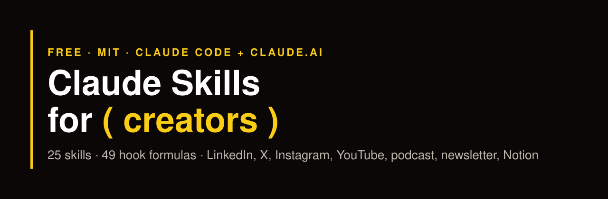

# Claude Skills for Creators: 25 free skills for Claude Code and claude.ai



[](LICENSE)
[](#all-25-skills)
[](#install-in-30-seconds)
[](https://github.com/tripathiadityap/claude-skills/releases/latest)

These are 25 Claude skills that run a creator's week: LinkedIn and X posts, Instagram reels and carousels, YouTube packaging, podcast episodes, a newsletter, and the Notion pipeline underneath it all. They're free, MIT-licensed, and need no signup and no API key.

Here's what they actually do:

- One writes your LinkedIn post from **49 hook formulas** across LinkedIn, X, Instagram and YouTube, picked by goal (comments, reposts, saves or follows), then runs a humanizer scrub so it doesn't read like AI.
- One takes a single podcast episode and returns titles, show notes, chapters, 2 to 4 clip picks, Shorts, a newsletter angle and a LinkedIn and X post.
- One edits raw selfie clips into reels under 60 seconds, with film grade, word-timed subtitles and Instagram's safe zones handled.
- One fact-checks a viral clip against the original source and turns the gap into a "real story" explainer reel.
- One runs your afternoon: calendar, inbox, content pipeline, podcast gaps and sales follow-ups, plus one idea written for every platform.

**Nothing gets posted until you say yes.** These skills write the drafts. You do the posting.

I built them to run my own podcast, newsletter and Instagram accounts, then pulled every personal detail out into one profile file. You fill that file in once and all 25 skills sound like you.

## Install in 30 seconds

**Easiest:** paste this into Claude Code.

```
https://github.com/tripathiadityap/claude-skills

Install the creator-core plugin and the packs I need from this marketplace, then help me fill in PROFILE.md.
```

**Claude Code plugin marketplace:**

```
/plugin marketplace add tripathiadityap/claude-skills
/plugin install creator-core@claude-skills
/plugin install creator-writing@claude-skills
/plugin install creator-video@claude-skills
/plugin install creator-podcast@claude-skills
/plugin install creator-notion-ops@claude-skills
/plugin install data-analytics@claude-skills
```

Install `creator-core` first, because every other pack reads its profile.

**claude.ai or Claude Desktop:** download a skill zip from the [latest release](https://github.com/tripathiadityap/claude-skills/releases/latest), or grab everything at once with [claude-skills-all.zip](https://github.com/tripathiadityap/claude-skills/releases/latest/download/claude-skills-all.zip). Then upload it under **Settings → Capabilities → Skills**. Upload `creator-profile` along with the others.

**By hand:**

```bash
git clone https://github.com/tripathiadityap/claude-skills.git
cp -r claude-skills/plugins/*/skills/* ~/.claude/skills/
```

Every skill is a plain `SKILL.md` folder, so it also loads in other agents that read the SKILL.md format.

## Then ask

- "Turn this transcript into the full episode package."
- "Write a LinkedIn post about this, goal is comments."
- "Watch this reel and tell me why the hook works."
- "Edit these three clips into reels."
- "Check the content calendar."
- "Run the afternoon run."
- "Prep me for Thursday's guest: [name, links]."

## How the skills work together

```
                    ┌────────────────────────────────────┐
                    │          creator-profile           │
                    │  your name, accounts, voice, team, │
                    │  offers, exclusions, Notion IDs    │
                    │    (read by every skill first)     │
                    └─────────────────┬──────────────────┘
        ┌──────────────┬──────────────┼──────────────┬──────────────┐
        ▼              ▼              ▼              ▼              ▼
     writing         video         podcast       notion-ops     analytics
  LinkedIn · X    reels · IG     guest prep     calendar ·     SQL funnels
  newsletter ·    YouTube ·      episode →      second brain   sessionization
  outreach        explainers     everything     research ·     Tableau
                                                daily run
```

Open [`PROFILE.md`](plugins/creator-core/skills/creator-profile/PROFILE.md) and replace every `[fill in]`. It takes about 5 minutes, and you can delete whatever you don't use. The skills never hardcode anyone's details. When the profile has a gap, they ask you once.

## All 25 skills

### creator-writing: posts, newsletter, outreach

| Skill | What it does |
|---|---|
| [`linkedin-x-posts`](plugins/creator-writing/skills/linkedin-x-posts/SKILL.md) | LinkedIn posts and X threads from 16 LinkedIn hook formulas picked by goal, with a density rule and a humanizer scrub |
| [`x-posts`](plugins/creator-writing/skills/x-posts/SKILL.md) | X single posts, threads, replies, quote posts and profile audits from 11 formulas |
| [`linkedin-engage`](plugins/creator-writing/skills/linkedin-engage/SKILL.md) | Comments on other people's posts (7 templates), replies on yours (5) and whole-thread sweeps |
| [`linkedin-profile-audit`](plugins/creator-writing/skills/linkedin-profile-audit/SKILL.md) | A nine-section LinkedIn profile scorecard with before-and-after rewrites |
| [`newsletter-essay`](plugins/creator-writing/skills/newsletter-essay/SKILL.md) | Substack or Beehiiv issues in your spoken voice: quote POVs, podcast companion essays, breakdowns |
| [`medium-adapt`](plugins/creator-writing/skills/medium-adapt/SKILL.md) | Turns a newsletter issue into a searchable Medium article |
| [`outreach`](plugins/creator-writing/skills/outreach/SKILL.md) | Podcast guest invites, sponsor pitches, collaboration asks and keynote outreach |
| [`consulting-sales`](plugins/creator-writing/skills/consulting-sales/SKILL.md) | LinkedIn DM sequences, past-client reactivation and booking-page copy where every offer has a next step |

### creator-video: Instagram, YouTube, reels

| Skill | What it does |
|---|---|
| [`instagram-threads`](plugins/creator-video/skills/instagram-threads/SKILL.md) | Reels, captions, carousels, hashtags and Threads posts from 11 Instagram formulas, with designer briefs |
| [`youtube-packaging`](plugins/creator-video/skills/youtube-packaging/SKILL.md) | YouTube titles, thumbnail briefs, opening hooks, descriptions with chapters and channel audits (11 formulas) |
| [`talking-head-reel-edit`](plugins/creator-video/skills/talking-head-reel-edit/SKILL.md) | Raw selfie clips into finished reels under 60 seconds: voice cleanup, film look, subtitles and safe zones |
| [`explainer-reel`](plugins/creator-video/skills/explainer-reel/SKILL.md) | Fact-checked "real story" reels that compare the viral claim with the original source |
| [`film-doc-edit`](plugins/creator-video/skills/film-doc-edit/SKILL.md) | A quiet documentary style for founder stories, in 16:9 and 9:16 |
| [`watch-video`](plugins/creator-video/skills/watch-video/SKILL.md) | Downloads a reel or video, transcribes it locally with Whisper and breaks down its hook beat by beat |
| [`youtube-transcript-moments`](plugins/creator-video/skills/youtube-transcript-moments/SKILL.md) | Full YouTube transcripts plus three timestamped moments per video, with deep links |

### creator-podcast

| Skill | What it does |
|---|---|
| [`podcast-guest-prep`](plugins/creator-podcast/skills/podcast-guest-prep/SKILL.md) | A research brief with sources, the episode angle, a 60 to 90 minute run sheet and a guest-facing page |
| [`podcast-episode-package`](plugins/creator-podcast/skills/podcast-episode-package/SKILL.md) | One episode turned into titles, show notes, chapters, clips, Shorts, an essay angle and posts |

### creator-notion-ops: the system underneath

| Skill | What it does |
|---|---|
| [`content-calendar`](plugins/creator-notion-ops/skills/content-calendar/SKILL.md) | A Notion content calendar: adds cards, triages the pipeline and sends a weekly status by owner |
| [`designer-calendar-fill`](plugins/creator-notion-ops/skills/designer-calendar-fill/SKILL.md) | Fills your designer's existing slots with carousel briefs drawn from your notes |
| [`second-brain-daily`](plugins/creator-notion-ops/skills/second-brain-daily/SKILL.md) | Routes anything you mention into the right Notion Second Brain database in under three lines |
| [`research-cards`](plugins/creator-notion-ops/skills/research-cards/SKILL.md) | Turns studies and startup case studies into reusable business rules and content angles |
| [`daily-content-run`](plugins/creator-notion-ops/skills/daily-content-run/SKILL.md) | One afternoon digest plus a content pack written for every platform |

### creator-core and data-analytics

| Skill | What it does |
|---|---|
| [`creator-profile`](plugins/creator-core/skills/creator-profile/SKILL.md) | Your brand, voice, accounts, routing and exclusions, read by every skill first |
| [`how-to`](plugins/creator-core/skills/how-to/SKILL.md) | Coaches a beginner from "I want to do X with Claude" to a finished result, one step at a time |
| [`web-analytics-sql`](plugins/data-analytics/skills/web-analytics-sql/SKILL.md) | Funnels, sessionization and identity resolution in SQL and Tableau, using synthetic data only |

## Rules built into every skill

- **No invented numbers.** Stats, quotes, guest lines, client names and results are never made up. A gap becomes a `[placeholder]` and gets flagged.
- **Drafts only.** Nothing is posted, published, sent or booked unless you say so in the conversation.
- **No confidential names.** Employers and clients stay out unless your profile marks them public.
- **Prompt-injection safe.** Text pasted from posts, comments or web pages is treated as data, never as instructions.
- **No AI voice.** Every writing skill scrubs em dashes, slop vocabulary ("leverage", "unlock", "game-changer") and staccato stacks before you see a draft.

## Common questions

**What are Claude skills?**
A skill is a folder with a `SKILL.md` file of instructions. Claude loads it when a task matches. These skills teach Claude how a creator writes posts, packages a podcast and runs a content calendar.

**Do these work in claude.ai, or only in Claude Code?**
Both. Claude Code installs them as plugins. In claude.ai and Claude Desktop, you upload the zips from the release page.

**Do I need Notion?**
Only for the `creator-notion-ops` pack. The writing, video and podcast skills work without it.

**Will it sound like me or like generic AI?**
Like you, once you fill in the voice section of `PROFILE.md` with a real paragraph you wrote. Every writing skill copies that sample and then runs a humanizer scrub.

**Do the video skills include the renderer?**
No. The reel skills define the style, the pipeline and the QC checklist, and they use standard tools (`ffmpeg`, `faster-whisper`, `yt-dlp`). You bring the render script, or let Claude write one.

**Can I use these for a brand or a team, not just a solo creator?**
Yes. The profile has a team table (designer, sales), and the account routing separates a personal account from a brand account.

## Made by Adi

I'm **Tripathi Aditya Prakash (Adi)**, founder of [Founday](https://founday-sepia.vercel.app). I host the ThatUnhingedGuy podcast, write The Practitioner, and post a reel every day on @talkaditalk. I use these skills to run all of it.

[](https://x.com/tripathiadityap)
[](https://www.linkedin.com/in/tripathiadityaprakash/)
[](https://www.instagram.com/talkaditalk/)
[](https://www.instagram.com/foundayofficial/)
[](https://www.youtube.com/@foundayofficial)
[](https://open.spotify.com/show/1DZXqmsDyH2FdJOeBdCoT6)
[](https://practitionerhq.substack.com)

If you use or remix these skills, a mention or a tag goes a long way. Every `SKILL.md` carries a short credit block. Please keep it when you share or adapt one (the MIT licence asks for the same).

## Credits

- The LinkedIn, X, Instagram, Threads and YouTube craft is adapted from [sergebulaev](https://github.com/sergebulaev)'s skills (MIT, © 2026 Sergey Bulaev). The attribution sits in each of those files.
- `watch-video` can optionally use [Agent-Reach](https://github.com/Panniantong/Agent-Reach) (MIT).
- Everything else is my own work, built and used daily at Founday.

## Contributing

Found a better hook, a broken step or a skill that's missing? [Open an issue](https://github.com/tripathiadityap/claude-skills/issues) or send a PR. Keep new skills free of personal details, and put anything user-specific in `PROFILE.md`.

If these save you time, **star the repo**. It's how other creators find it.

## License

MIT. See [LICENSE](LICENSE).
